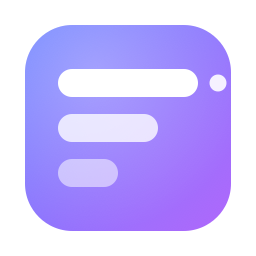

# QuotaBar

一个 macOS 菜单栏 + 桌面小组件工具，用来看各家 AI 模型 / 平台的**剩余额度**，并且可以在小组件里随时切换显示哪一个供应商。



## 支持的供应商

| 供应商 | 显示内容 | 数据来源 | 需要什么 |
| --- | --- | --- | --- |
| OpenRouter | 账户余额、本密钥剩余额度 | `/api/v1/credits`、`/api/v1/key` | API Key |
| DeepSeek | 账户余额（充值 / 赠送拆分） | `/user/balance` | API Key |
| Kimi (Moonshot) | 可用余额、代金券 | `/v1/users/me/balance` | API Key |
| SiliconFlow 硅基流动 | 可用余额、充值余额 | `/v1/user/info` | API Key |
| SoloAPI 中转站 | 账户余额、今日消费、累计消费、Token 用量 | `/v1/usage` | API Key |
| Claude Code 订阅 | 5 小时窗口 / 7 天窗口 / Opus / Sonnet 剩余百分比 + 重置倒计时 | `api.anthropic.com/api/oauth/usage` | 本机已登录 Claude Code |
| OpenAI 组织用量 | 本月花费、本月 Token | `/v1/organization/costs`、`/v1/organization/usage` | Admin Key（`sk-admin-`） |
| 自定义接口 | 任意返回 JSON 的接口 | 你自己填地址和字段路径 | 接口地址 |

关于「剩余额度」这件事需要说清楚：

* **OpenRouter / DeepSeek / Kimi / 硅基流动 / SoloAPI** 有官方余额接口，是真正意义上的「还剩多少钱」。
* **SoloAPI** 用的是它自家的接口，不是 one-api / new-api 那套约定：`GET /v1/usage` 一次返回余额、套餐名、今日消费、累计消费和 Token 用量（实测确认，余额单位 USD）。
* **Claude Code（Claude Pro / Max 订阅）** 没有公开的额度 API，但 Anthropic 给 Claude Code 客户端用的 OAuth usage 接口会返回 5 小时 / 7 天窗口的使用率，QuotaBar 读的就是它 —— 这是目前唯一能拿到订阅限额的可靠途径。
* **OpenAI** 不提供任何「剩余额度」接口，ChatGPT 订阅的额度也不对外。这里只能给管理员密钥能查到的组织本月花费，属于「已用」而不是「剩余」，界面上也如实标注。

> **从旧版本升级**：如果你之前把 SoloAPI 配成了「自定义接口」（指向对话用的 `/v1`、Key 塞在自定义请求头里），
> 打开新版会自动识别并升级成 SoloAPI 供应商，Key 会搬到凭证栏，不用重新填。

## 安装

1. 把 `QuotaBar.app` 拖进 `/Applications`（**必须放进去**，桌面小组件只认「应用程序」目录里的 App）。
2. 双击运行一次。首次打开如果被 Gatekeeper 拦下，右键 App →「打开」。
3. 点菜单栏的仪表盘图标 →「主界面」→「添加」，选一家供应商，填入 API Key。

## 添加桌面小组件

1. 确认 App 已经放进 `/Applications` 并且运行过一次。
2. 在桌面空白处**右键 →「编辑小组件…」**（或者点菜单栏时间打开通知中心，滚到底部）。
3. 搜索 `QuotaBar`，选中小 / 中 / 大尺寸拖到桌面。

**切换显示哪个 AI（两种方式）**

* **跟随 App（默认）**：在 App 里点某个供应商卡片右上角 `⋯` →「设为小组件默认项」，桌面小组件会**立刻**切过去。
* **固定显示**：右键桌面上的小组件 →「编辑小组件…」→ 把「显示方式」改成「固定显示」，再选具体供应商。这样它就不会跟着 App 变了。

小组件里如果显示的还是旧的那家，先检查「显示方式」是不是被设成了「固定显示」；
实在不对就把小组件从桌面删掉重新拖一个。设置页里有「立即重载小组件」按钮可以手动催一下。

菜单栏也会实时显示当前选中供应商的额度。

## 后台运行与刷新频率

**关掉主窗口不会退出程序。** App 会留在菜单栏，按设定的间隔继续在后台刷新；
想彻底退出请点菜单栏图标 →「退出」。

刷新间隔在「设置 → 刷新」里选，支持 **1 分钟 / 2 分钟 / 5 分钟 / 10 分钟 / 30 分钟 / 1 小时**。

两个实现细节值得一提：

* **App Nap。** macOS 会把后台 App 的定时器合并、延后执行，1 分钟的设定很可能变成好几分钟才跑一次。
  所以 App 启动时声明了一个 `ProcessInfo.beginActivity(.userInitiatedAllowingIdleSystemSleep)`，
  让定时器按时触发，同时仍然允许系统空闲休眠（不会硬撑着不让电脑睡）。
* **开机自动启动。** 用 `~/Library/LaunchAgents/com.dongyu.quotabar.plist`（RunAtLoad）实现。
  没用 `SMAppService`，因为它要求 App 有正式签名并放在「应用程序」里，本工程是 ad-hoc 签名，注册会失败。
  勾选前请先把 QuotaBar.app 放进「应用程序」，否则设置页会给出明确提示。

**关于 1 分钟刷新**：适合盯 Claude Code 的 5 小时窗口。但余额类接口
（OpenRouter / DeepSeek / Kimi / 硅基流动）一般都有频率限制，长期 1 分钟一次等于每天 1440 次请求，
有被限流的风险，日常建议 5–10 分钟。

**关于小组件**：桌面小组件本身由系统调度，系统不允许它低于约 15 分钟自我刷新。
App 会主动调用 `WidgetCenter.reloadAllTimelines()` 通知小组件更新，但**这个调用是有预算的**
（系统大约只给每天几十次），所以 App 做了节流：

* **换供应商 / 改配置** → 立刻重载，保证你切完马上能看到；
* **例行刷新** → 最多每 10 分钟推一次，剩下的交给小组件自己的时间线。

早期版本没做节流，1 分钟刷新会把这个预算烧光，结果真正需要立刻生效的那次反而被系统丢掉 ——
这也是「在 App 里换了 API，小组件不动」的原因之一。

## 脚本

`build.sh` 会编译并安装到 `/Applications`：

```bash
./build.sh            # 编译 Release 并安装
./build.sh debug      # 编译 Debug 版本
```

## 从 Xcode 打开

直接双击 `QuotaBar.xcodeproj`。两个 target：

* `QuotaBar` —— 主 App（菜单栏 + 主窗口 + 设置）
* `QuotaBarWidget` —— 桌面小组件扩展

改完代码在 Xcode 里 Run 一次即可（Xcode 会自动把 App 装到 DerivedData 并注册小组件）。

## 工程结构

```
QuotaBar/
├── Shared/                 主 App 与小组件共用
│   ├── Models.swift        额度指标 / 供应商配置 / 持久化模型
│   ├── Formatting.swift    金额、百分比、重置倒计时、JSON 取值
│   ├── HTTP.swift          网络请求与错误文案
│   ├── SharedStore.swift   两边共享数据文件
│   ├── QuotaService.swift  并发刷新
│   ├── Components.swift    共用 UI 组件
│   └── Providers/          每家供应商一个适配器，新增一家就是加一个文件
├── QuotaBar/               主 App
│   ├── AppModel.swift      状态与自动刷新
│   ├── QuotaBarApp.swift   三个 Scene：主窗口 / 菜单栏 / 设置
│   ├── LaunchAtLogin.swift 开机自动启动（LaunchAgent）
│   └── Views/
├── QuotaBarWidget/         桌面小组件
│   ├── ProviderIntent.swift  小组件的「供应商」下拉（AppIntent）
│   └── QuotaWidget.swift     时间线 + 小 / 中 / 大三种布局
└── Config/                 Info.plist 与 entitlements
```

### 新增一家供应商

在 `Shared/Providers/` 新建一个文件，实现 `QuotaProvider`：

```swift
struct MyProvider: QuotaProvider {
    let kind: ProviderKind = .myProvider          // 在 Models.swift 里加一个 case
    func fetch(config: ProviderConfig) async throws -> [QuotaMetric] {
        let response = try await HTTPClient.json(
            "https://example.com/balance",
            headers: ["Authorization": "Bearer \(config.credential)"]
        )
        guard let object = response.object else { throw QuotaError.noValue }
        return [try MyProvider.metric(from: object)]
    }
    static func metric(from object: Any) throws -> QuotaMetric { ... }
}
```

然后在 `ProviderRegistry.provider(for:)` 里注册即可，界面和小组件会自动出现这一项。

如果只是接一个私有接口，不用写代码，直接用「自定义接口」类型，填地址 + 字段路径就行。

## 数据存在哪

主 App 与小组件通过一个 JSON 文件共享状态，主 App 会往下面所有能写的位置各写一份（未沙盒 App 有权限同时写这些位置）：

1. `~/Library/Group Containers/group.com.dongyu.quotabar/QuotaBar/state.json`
2. `~/Library/Application Support/QuotaBar/state.json`
3. `~/Library/Containers/com.dongyu.quotabar.widget/Data/Library/Application Support/QuotaBar/state.json`

小组件是沙盒化的，它读的是自己的容器（第 3 条）；按 Launch 顺序不同，第 2 条会在 App 运行时兜底。设置页里有这三条路径的实时诊断（是否可写、最后更新时间）。

> **为什么不用 App Group？** App Group 是标准做法，但它属于受限权限，必须有开发者团队和描述文件。这个仓库用的是 ad-hoc 签名（不需要付费开发者账号），此时 `containerURL(forSecurityApplicationGroupIdentifier:)` 会直接返回 nil —— 我实测确认过。所以走了「多位置写一份」的方案。
>
> 如果你有自己的 Apple Developer Team，想要更规范的做法：把 `Config/*.entitlements` 里的 `com.apple.security.application-groups` 加回去，在 Xcode 的 Signing & Capabilities 里选好 Team，再把主 App 的 `com.apple.security.app-sandbox` 改成 `true`。`SharedStore` 会自动优先使用 App Group 容器，其它路径依然作为兜底。注意主 App 开了沙盒后就**读不到** `~/.claude/.credentials.json` 了，Claude Code 那一项会失效。

## 关于安全

API Key 和 Claude Code 的 OAuth 令牌会以**明文**存在上面那个 `state.json` 里，文件权限是当前用户的默认权限。这是为了让沙盒化的小组件也能自己发起请求（否则 App 不运行时小组件就没数据）。如果你的机器是多用户共用，或者对密钥落盘敏感，请谨慎填入长期密钥。

Claude Code 那一项会读取 `~/.claude/.credentials.json`，如果文件不存在则尝试读钥匙串里的 `Claude Code-credentials`（系统会弹窗询问，选「始终允许」）。access token 过期时 QuotaBar 会用 refresh token 续期，并**写回原位置** —— 这是必须的，因为 Anthropic 的 refresh token 是轮换的，不回写会把 Claude Code 自己的登录态搞坏。

## 已知限制

* 小组件刷新由系统调度，实际间隔通常 15–30 分钟，不保证准点。
* 余额类接口一般有频率限制，默认 10 分钟刷新一次，不建议调到 5 分钟以下。
* 各家返回结构可能随时变；解析失败时卡片上会显示原始错误信息，方便定位。
* 打包为 Release 使用 ad-hoc 签名，首次打开需要右键 → 打开。

## 环境要求

* 运行：macOS 14.0 (Sonoma) 及以上（桌面小组件需要 macOS 14+）。
* 编译：Xcode 16 或更高版本。工程用的是 Xcode 16 引入的 folder-based 项目结构（`PBXFileSystemSynchronizedRootGroup`），新增 Swift 文件不需要手动拖进 target，放进目录即可。本工程在 Xcode 27 / Swift 6.4 上验证通过，`SWIFT_VERSION` 设为 5.0。
